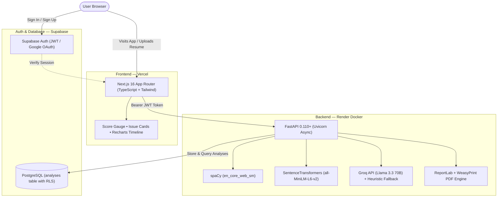

<div align="center">

# 🎯 AI-Powered ATS Resume Scorer & Career Intelligence

**Beat Applicant Tracking Systems with Semantic Proof, Real Evidence Validation, and Instant PDF Reports.**

[](https://ats-resume-checker-nine-lake.vercel.app)
[](https://ats-resume-checker-api-soji.onrender.com/docs)
[](https://ats-resume-checker-api-soji.onrender.com/api/v1/health)
[](tests/)
[](web/)
[](web/)
[](supabase/)

[**Explore Live Web App 🚀**](https://ats-resume-checker-nine-lake.vercel.app) • [**API Reference 📖**](https://ats-resume-checker-api-soji.onrender.com/docs) • [**Deployment Guide 🛠️**](DEPLOY.md)

</div>

---

## 🌟 Overview

Modern Applicant Tracking Systems (ATS) don't just match keywords anymore—they evaluate **semantic similarity**, **contextual relevance**, and **validated proof of skills**.

**ATS Resume Intelligence** is a production-grade full-stack platform designed to analyze resumes against modern ATS filters in real time. It uses SentenceTransformers (`all-MiniLM-L6-v2`) and spaCy NLP for embedding extraction, Groq Llama 3.3 70B for deep feedback generation, and Supabase for authenticated user histories.

---

## ⚡ Core Features

- 🎯 **Dual Scoring Modes**:
  - **General ATS Compatibility**: Audits resume structure, bullet point metrics, action verbs, and privacy risks without requiring a job description.
  - **Job Description Semantic Match**: Computes cosine similarity of dense vector embeddings, missing keywords, and role-specific skill gaps.
- 🔬 **Substantiated Skill Validation**: Checks whether claimed technical skills are substantiated by actual projects and measurable experience bullet points.
- 📊 **Dynamic Visualizations**: High-precision SVG circular score gauges, component breakdown bars, and historical score progression timelines using Recharts.
- 📄 **Exportable PDF Reports**: Downloads professional ATS audit reports generated via WeasyPrint and ReportLab pure-Python fallbacks.
- 🔒 **Enterprise Authentication & Security**: Complete Supabase SSR auth (Email/Password & Google OAuth) with Row Level Security (RLS) PostgreSQL database.
- ⚡ **Resilient Local Fallbacks**: Heuristic NLP fallbacks ensure resume parsing and scoring succeed even when LLM or external APIs are unavailable.

---

## 🏗️ System Architecture



---

## 🛠️ Tech Stack

| Layer | Technologies |
|---|---|
| **Frontend** | [Next.js 16 (App Router)](https://nextjs.org), [TypeScript](https://www.typescriptlang.org), [Tailwind CSS v4](https://tailwindcss.com), [Recharts](https://recharts.org), [Lucide React](https://lucide.dev), [@supabase/ssr](https://supabase.com) |
| **Backend** | [FastAPI](https://fastapi.tiangolo.com), [Python 3.11](https://python.org), [Uvicorn](https://www.uvicorn.org), [Pydantic v2](https://docs.pydantic.dev), [SlowAPI](https://github.com/laurentS/slowapi) |
| **NLP & AI** | [spaCy](https://spacy.io), [SentenceTransformers](https://sbert.net) (`all-MiniLM-L6-v2`), [Groq](https://groq.com) (Llama 3.3 70B Versatile) |
| **Document Processing** | [pdfplumber](https://github.com/jsvine/pdfplumber), [python-docx](https://python-docx.readthedocs.io), [ReportLab](https://www.reportlab.com), [WeasyPrint](https://weasyprint.org) |
| **Database & Auth** | [Supabase PostgreSQL](https://supabase.com) with Row Level Security (RLS) |
| **DevOps & Hosting** | [Docker](https://docker.com), [Render](https://render.com), [Vercel](https://vercel.com) |
| **Testing** | [Pytest](https://pytest.org) (19 backend tests), [Playwright](https://playwright.dev) (E2E Chromium test suite) |

---

## 📂 Repository Layout

```
ATS_RESUME_CHECKER/
├── backend/                  # FastAPI Application
│   ├── api/                  # REST endpoints & Supabase JWT auth middleware
│   ├── core/                 # App configuration, scoring weights & canonical constants
│   ├── database/             # Async Supabase PostgreSQL REST client
│   ├── models/               # Pydantic validation schemas
│   ├── services/             # NLP engine, Groq parser, feedback engine, PDF export
│   └── utils/                # Rate limiter & string sanitizer utilities
├── web/                      # Next.js 16 Web Application
│   ├── src/app/              # App Router routes (/, /scorer, /history, /resources, /login)
│   ├── src/components/       # UI components (ScoreGauge, ComponentBar, IssueCard, Navbar)
│   ├── src/lib/              # Typed API client, Supabase SSR helpers, utility classes
│   ├── e2e/                  # Playwright end-to-end smoke test suite
│   └── vercel.json           # Production security headers
├── supabase/                 # Database migrations (schema.sql with RLS policies)
├── tests/                    # Pytest test suite (Phase 1 sanity, Phase 2 routes, Phase 3 feedback)
├── Dockerfile                # Production container spec (CPU-only PyTorch, pre-cached models)
├── render.yaml               # Render Infrastructure-as-Code Blueprint
└── DEPLOY.md                 # Step-by-step production deployment guide
```

---

## 🚀 Local Development Quickstart

### 1. Prerequisites
- Python 3.10+
- Node.js 18+ (Node 20+ recommended)
- Git

### 2. Backend Setup
```bash
# Clone the repository
git clone https://github.com/Shivam95800/ATS_RESUME_CHECKER.git
cd ATS_RESUME_CHECKER

# Set up virtual environment
python -m venv venv
# On Windows:
venv\Scripts\activate
# On Linux/macOS:
source venv/bin/activate

# Install backend dependencies & spaCy model
pip install -r requirements.txt
python -m spacy download en_core_web_sm

# Configure environment variables
copy .env.example .env

# Run backend development server
python -m uvicorn backend.main:app --host 0.0.0.0 --port 8000 --reload
```
API Swagger documentation is available at [http://localhost:8000/docs](http://localhost:8000/docs).

### 3. Frontend Setup
```bash
cd web

# Configure frontend environment variables
copy .env.example .env.local

# Install dependencies
npm install

# Start Next.js development server
npm run dev
```
Open [http://localhost:3000](http://localhost:3000) in your browser.

---

## 🧪 Testing

### Backend Unit & Integration Tests (19/19 Passing)
```bash
# Run pytest test suite
python -m pytest tests/ -v
```

### Frontend E2E Smoke Tests (Playwright)
```bash
cd web
npm run test:e2e
```

---

## 🛡️ Security

- **Row Level Security (RLS)**: Users can only query, insert, or delete their own resume analyses in Supabase.
- **JWT Cryptographic Verification**: Backend enforces `SUPABASE_JWT_SECRET` HS256 token verification on all protected endpoints.
- **Sanitized Uploads**: 5 MB file size boundary check, extension and magic byte validation.
- **Strict Headers**: Includes `X-Content-Type-Options: nosniff`, `X-Frame-Options: DENY`, `Strict-Transport-Security`, and granular Content Security Policies.

---

## 👤 Author

**Shivam Soni**
- **GitHub**: [@Shivam95800](https://github.com/Shivam95800)
- **Live Project**: [ats-resume-checker-nine-lake.vercel.app](https://ats-resume-checker-nine-lake.vercel.app)
- **Email**: [shivam301102@gmail.com](mailto:shivam301102@gmail.com)

---

## 📄 License

This project is licensed under the [MIT License](LICENSE).
